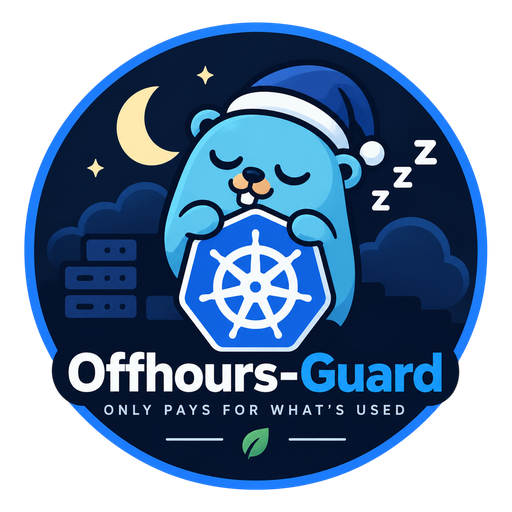

<div align="center">
  

  # Offhours-Guard

  **A Kubernetes operator that only pays for what's used.**

  [](https://github.com/TheGostsniperfr/offhours-guard/actions/workflows/build-and-push.yml)
  [](https://github.com/TheGostsniperfr/offhours-guard/actions/workflows/publish-helm.yml)
</div>

## What it does

Most non-production Kubernetes environments run 24/7 for no reason: nobody is testing against staging at 3am. Offhours-Guard is a Go operator, built around its own `OffhoursSchedule` CRD, that automatically scales those environments down to 0 replicas outside working hours and restores them on wake-up, with a one-click manual override when you need one right now.

Deployed on most of the [Cloud Native Platform](https://about.arffornia.com/Projects/CNP)'s non-critical applications, it cuts up to **-70% cost** on non-production environments and reduces nightly activity from 24/7 to a 1am-7am window.

## How it works

- **Reconciler, not a cron job.** The controller scales deployments down to 0 replicas at the scheduled time, but remembers the original replica count so wake-up restores the exact prior state, not a blind "1 replica" default.
- **`OffhoursSchedule` CRD.** Each app declares its sleep/wake schedule as cron expressions with a timezone, targeting one or more workloads.
- **Web dashboard.** A Tailwind + HTMX UI lists every managed app with its state (Active / Asleep), current vs. original replica count, and the cron schedule, with a one-click button to force a wake-up or a manual sleep, auto-refreshing every 15 seconds.
- **Honest monitoring.** A service that's intentionally stopped shouldn't fire an alert as if it had crashed. Offhours-Guard exposes an endpoint that health-check tools (e.g. [Gatus](https://github.com/TwiN/gatus)) can query instead of the real service: it returns `200 OK` with a `SLEEPING (managed by Offhours-Guard)` status during the sleep window, and faithfully proxies the app's real status outside it.

## Installation

```bash
helm install offhours-guard oci://ghcr.io/thegostsniperfr/charts/offhours-guard --version <version>
```

See [`chart/values.yaml`](chart/values.yaml) for configuration options.

## Example

```yaml
apiVersion: guard.3istor.com/v1alpha1
kind: OffhoursSchedule
metadata:
  name: my-app-offhours
spec:
  targetRefs:
    - kind: Deployment
      name: my-app
```

## Metrics

Served on `:8083/metrics` (controller-runtime endpoint). `target` is `<kind>/<name>`, e.g. `Deployment/my-app`. The chart annotates the pod for Prometheus/Alloy scraping.

| Metric | Type | Labels | Meaning |
|---|---|---|---|
| `offhours_target_asleep` | gauge | `namespace`, `schedule`, `target` | 1 while the target is scaled down by the controller, else 0 |
| `offhours_target_original_replicas` | gauge | `namespace`, `schedule`, `target` | Replicas the target had before sleeping, restored on wake |
| `offhours_target_asleep_seconds_total` | counter | `namespace`, `schedule`, `target` | Cumulative seconds spent asleep, credited at each reconcile (resets on restart) |
| `offhours_transitions_total` | counter | `namespace`, `schedule`, `direction`, `result` | Sleep/wake attempts, `direction` is `sleep` or `wake`, `result` is `success` or `error` |

Gauge series are removed when a schedule is deleted or a target leaves it.

## Stack

Go (`controller-runtime`) · Kubernetes CRD & Reconciler · Helm · Docker · GitHub Actions CI, image and chart published continuously to `ghcr.io`.

## What's next

A recommendation engine, both statistical and AI-assisted, to dynamically suggest better sleep/wake schedules to cluster admins and to users themselves.

---

Part of the [Cloud Native Platform](https://about.arffornia.com/Projects/CNP) · [Brian Perret](https://about.arffornia.com)
